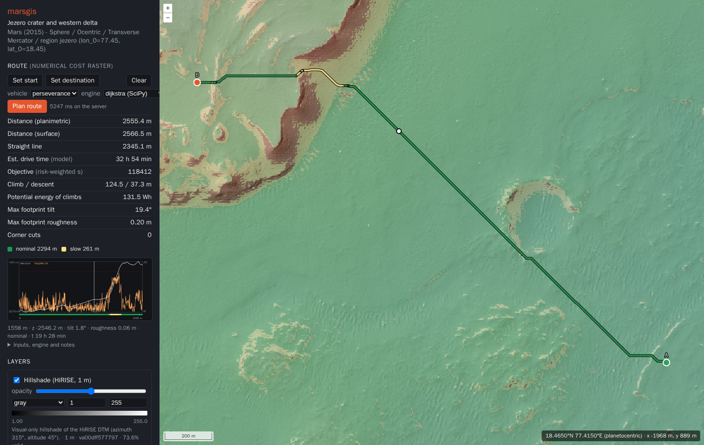

# marsgis — Mars exploration geospatial platform (prototype)

A verified vertical slice of a geospatial platform for planning Mars exploration routes:
real orbital terrain data → scientifically defined terrain features → a vehicle-specific,
uncertainty-aware traversability model → minimum-cost routes with diagnostics, all in
Mars-native coordinates. It:

1. downloads a **real Mars dataset**: the USGS Astrogeology controlled CTX DTM and
   orthoimage of **Jezero crater** (CC0, ~43 MB);
2. validates its metadata, records provenance, and warps it onto a **Mars-native
   regional grid** (IAU 2015 Mars sphere, planetocentric, east-positive, Transverse
   Mercator, 20 m);
3. derives **slope** and **hillshade** and writes versioned **Cloud Optimized GeoTIFFs**
   with STAC metadata;
4. serves tiles through **TiTiler** in Mars TileMatrixSets only (no Web Mercator, no
   Earth CRS anywhere), plus a multi-layer **pixel-inspection** API;
5. displays the layers in an **OpenLayers** map rendered in the regional Mars CRS. Each
   layer has its own visibility, opacity, colormap, rescale and legend, and clicking the
   map inspects every layer at that point;
6. ingests the **original HiRISE stereo DTM** (PDS3, 1 m) over the crater floor and delta
   front, and keeps its native posting on a 1 m grid nested in the regional grid;
7. derives **rover-footprint terrain features** (5 m plane-fit tilt and roughness, as in
   JPL's GESTALT), validated analytically and on the real data;
8. applies a **vehicle-specific traversability model** (Perseverance-like, every parameter
   labelled published / derived / assumption) with uncertainty bands. Unknown terrain is
   never treated as safe;
9. plans **minimum-cost routes** with SciPy and scikit-image Dijkstra on the numerical
   cost raster, returning geometry, distance, drive-time estimate, elevation and
   tilt/roughness profiles, class breakdown and input versions. Routes can be planned in
   the web map (click A and B).



## Stack

| Layer | Choice |
|---|---|
| Runtime | Docker Compose (arm64-native on Apple Silicon; amd64 works too) |
| Processing | Python 3.12, rasterio 1.5.2 (GDAL 3.12.2, PROJ 9.8.1 with IAU_2015; PDS3 driver), pyproj 3.8, NumPy, SciPy 1.18 (`ndimage`) |
| Planning | SciPy `sparse.csgraph.dijkstra` (default) and scikit-image 0.26 `graph.MCP_Geometric` |
| Storage | COG files on a bind-mounted `./data`, static STAC catalog |
| API | FastAPI + titiler.core 2.4 + morecantile 7.1 + planetcantile 0.6 |
| Web | Vite 8, TypeScript 5.9, OpenLayers 10.11, proj4js 2.22 |

The reasoning behind these choices is in [`docs/decisions.md`](docs/decisions.md), and the
evidence is in [`docs/research.md`](docs/research.md).

## Quick start

Requirements: Docker Desktop (or OrbStack) with at least 6 GB of memory for the
containers, about 3 GB of disk, and internet access on first run. Nothing else is
installed on the host.

```bash
docker compose up --build
```

* `init-data` downloads the sources (~425 MB: CTX from USGS, HiRISE DTM from the HiRISE
  PDS archive) and builds 12 layers. This takes about 3–5 minutes and happens only
  once, because later runs are no-ops.
* Open the web map at **http://localhost:5173**.
* Open the API docs at http://localhost:8000/api/docs.

### Everyday commands

```bash
docker compose up -d --build          # start in background (rebuilds images if changed)
docker compose logs -f api            # follow API logs (JSON lines)
docker compose down                   # stop; ./data is kept
docker compose build --no-cache       # rebuild images from scratch

# tests (unit + integration against the processed sample) and lint
docker compose run --rm api python -m pytest -q
docker compose run --rm api ruff check src tests

# pipeline CLI
docker compose run --rm init-data marsgis build --region jezero     # (re)build, idempotent
docker compose run --rm init-data marsgis route 77.4508,18.4447 77.4150,18.4650   # plan (JSON)
docker compose run --rm init-data marsgis sensitivity 77.4508,18.4447 77.4150,18.4650
docker compose run --rm init-data marsgis feature-stats --layer hirise_roughness_5m --above 0.35
docker compose run --rm init-data marsgis compare-dtm                # HiRISE vs CTX heights
docker compose run --rm init-data marsgis inspect /data/raw/ctx_dtm_P18_007925_P19_008650/<file>.tif
docker compose run --rm init-data marsgis inspect https://astrogeo-ard.s3-us-west-2.amazonaws.com/...tif
```

Source code is bind-mounted. The API reloads on changes under `backend/src` and `config`,
and Vite hot-reloads `frontend/src`. If you change dependencies (`backend/requirements.lock`
or `frontend/package.json`), rebuild with `--build`.

### Data persistence

| Path | Content | Disposable? |
|---|---|---|
| `data/raw/` | Verbatim downloads with `provenance.json` (SHA-256, URL, licence) | Yes, it is re-downloaded on the next build (~425 MB) |
| `data/processed/` | Versioned COGs, one directory per content-addressed version | Yes, it is rebuilt from `raw` and `config` |
| `data/catalog/` | STAC items pointing at the current versions | Yes, it is rebuilt |

`data/` is a plain directory in the repo checkout and is git-ignored. It survives
`docker compose down` and container recreation. Never commit it.

## Using the prototype

* **Navigate**: pan and zoom. The map is in the regional CRS, so the scale bar is in true
  Mars metres. Zoom 5 is exactly the 20 m analysis grid, and deeper zooms show the cells
  as squares.
* **Layers** (sidebar): toggle visibility and change opacity, colormap, and min/max
  rescale. Legends update automatically, and defaults come from per-layer statistics.
* **Inspect**: click anywhere to get every layer's value at that grid cell (with units,
  or `nodata`/`outside`). The location is shown in planetocentric and planetographic
  latitude, east ±180 and west 0–360 longitude, region x/y, and grid row/col. A
  browser-vs-server CRS agreement check is displayed under the values.
* **Plan a route**: in the *Route* panel press *Set start* and click the map, then
  click the destination and press *Plan route*. Waypoints must lie inside the HiRISE
  footprint (the dashed outline) on traversable terrain. The line is coloured by
  traversability class. The table gives distance, model drive time, climb, max
  tilt/roughness and class lengths. Hover the profile (elevation and footprint tilt
  against the 20° limit) to locate points on the map.
* **API examples**

  ```bash
  curl -X POST 'http://localhost:8000/api/regions/jezero/routes' -H 'Content-Type: application/json' \
       -d '{"waypoints":[{"lon":77.4508,"lat":18.4447},{"lon":77.4150,"lat":18.4650}],"vehicle":"perseverance"}'
  curl 'http://localhost:8000/api/vehicles/perseverance'                   # parameters + basis
  curl 'http://localhost:8000/api/regions/jezero'                          # CRS, grid, layers, stats
  curl 'http://localhost:8000/api/regions/jezero/inspect?lon=77.45&lat=18.45'
  curl 'http://localhost:8000/api/regions/jezero/inspect?x=1010&y=-2010'
  curl -o t.png 'http://localhost:8000/api/cog/tiles/MarsJezeroTM/5/16/16.png?region=jezero&layer=elevation&rescale=-2700,-1600&colormap_name=gist_earth'
  # TiTiler's point endpoint needs an explicit Mars CRS (its default is EPSG:4326):
  curl 'http://localhost:8000/api/cog/point/77.45,18.45?region=jezero&layer=elevation&coord_crs=IAU_2015:49900'
  ```

## Repository layout

```
compose.yaml             services: init-data (pipeline), api, web
config/
  sources.yaml           external sources: URL, licence, expected CRS/dtype/nodata, units,
                         declared vertical/relative precision
  regions/jezero.yaml    region CRS, grid, layer recipes, render defaults, planning layers
  vehicles/*.yaml        vehicle mobility parameters (value, unit, basis, source)
backend/
  Dockerfile, pyproject.toml, requirements.lock (uv pip compile --universal)
  src/marsgis/           crs, grid, ingest, processing, terrain, traversability, planning,
                         routing, sensitivity, quality, catalog, pipeline, tms, inspect, api/
  tests/                 64 tests: CRS, grids, warping/nodata, terrain (analytic),
                         traversability, planner (analytic + engine cross-check), API
frontend/                Vite + OpenLayers client (src/main.ts, src/route.ts, src/api.ts)
docs/                    research, terrain-analysis, traversability, path-planning,
                         architecture, decisions, data-model
data/                    (git-ignored) raw/, processed/, catalog/
```

## Adding a layer

* **Another source raster** (for example another HiRISE DTM or a THEMIS mosaic): add an
  entry to `config/sources.yaml` with its URL and expected CRS, dtype, nodata and units.
  Then add an `op: warp` recipe to `config/regions/jezero.yaml` with an explicit
  resampling method and a resolution of `20 / n` or `20 · n` (integer n), and run
  `marsgis build`.
* **Another vehicle**: copy `config/vehicles/perseverance.yaml`, then add three recipes
  (`traversability_class`, `traversal_time`, `traversal_cost`) and a `planning:` entry
  in the region config.
* **A derived layer**: implement the operation in `processing.py`, register an algorithm
  version in `ALGORITHM_VERSIONS`, add a test with an analytic expectation, and reference
  it with `op:` and `input:` in the region config.

The web client discovers layers from the API automatically.

## Current capabilities

All of the following are verified by tests and a headless-browser check.

* Mars-only CRS handling: Earth CRSs and missing CRSs are rejected. Ocentric/ographic
  latitude and east/west longitude conversions are tested.
* An aligned, nested, regional grid family: every published layer is checked for
  alignment.
* Content-addressed, idempotent, provenance-tracked builds, with raw data protected by
  checksums.
* Tiles at the base zoom are bit-identical to the analysis grid.
* Multi-layer pixel inspection that agrees with TiTiler's `/point` and with the raw COG.
* HiRISE PDS3 ingestion through GDAL, on a 1 m grid nested exactly in the 20 m grid.
  The HiRISE–CTX vertical offset is measured (−26.3 ± 8.6 m) and explained.
* Footprint tilt and roughness that are exact on analytic surfaces. Strip processing
  gives results identical to in-memory processing. The uncertainty formula is checked by
  Monte Carlo.
* Route planning with two independent Dijkstra engines that agree to the last digit on
  the real data. No corner cutting, unknown terrain blocked, structured errors, and
  profile values equal the rasters.
* Browser coordinate transforms that agree with server PROJ to about 1e-9 m. This
  required working around two proj4js defects; see `docs/research.md` §4.

## Limitations

* One region, one HiRISE DTM (~7 × 14 km). Routes can only be planned inside the HiRISE
  footprint; CTX and HiRISE are not fused, because their heights differ by ~26 m and
  need co-registration first.
* The traversability model is **experimental**: public-source parameters, no rock
  abundance (rocks below ~2–3 m are invisible to the DTM), no terrain classes (sand,
  ripples), heading-independent. Drive times are model estimates, not operational
  predictions. See `docs/traversability.md` §6 and the sensitivity analysis.
* 8-connected grid routes have 45° zig-zags and an octile distance bias of up to 8 %.
  Any-angle planning is the next step (`docs/path-planning.md` §6).
* Planning windows are capped at 8 M cells (~2.4 GB peak per request; at most 2
  concurrent requests).
* The orthoimage's physical unit is undocumented by the source, so it is displayed as
  relative brightness only.
* There is no STAC API, PostGIS or object storage yet. These are deliberately deferred,
  and the seams are in place (`docs/decisions.md` D9).
* No ML yet, deliberately: the analytic baseline comes first (`docs/research.md` §15).
* NASA challenge data formats are unknown. Ingestion currently handles GDAL-readable
  rasters only (GeoTIFF/COG, and in principle PDS3/PDS4/ISIS3 through GDAL, which is
  untested).
* The frontend has no lockfile committed yet. Direct dependencies are pinned exactly;
  generate one with
  `docker compose run --rm --no-deps -v "$PWD/frontend:/web" web npm install --package-lock-only`
  and commit it so that `npm ci` is used.

## Troubleshooting

* **`failed to fetch anonymous token … x509` during build**: something on the host
  (a corporate proxy or a sandbox) intercepts TLS for the BuildKit client. Use
  `DOCKER_BUILDKIT=0 docker compose build`, or fix the proxy CA in Docker's settings.
* **Map is empty**: check `docker compose logs init-data`. The first run needs internet
  access to `astrogeo-ard.s3-us-west-2.amazonaws.com`, `stac.astrogeology.usgs.gov` and
  `hirise-pds.lpl.arizona.edu`.
* **Route request returns 422**: the `detail.code` says why: `outside_coverage`
  (waypoint outside the HiRISE DTM), `waypoint_not_traversable` (on a hazard or unknown
  cell), `no_path`, or `window_too_large`.

## Suggested next steps

1. Validate against Perseverance's actual traverse through this DTM (public data).
2. Add a rock-abundance (CFA) layer from HiRISE 25 cm images, and terrain classes, as in
   JPL's Mars 2020 traversability tools.
3. Any-angle planning (Theta* / Field D*), then direction-dependent costs (pitch/roll,
   uphill energy) on a directed graph.
4. Co-register CTX and HiRISE vertically, then plan hierarchically (20 m regional →
   1 m local).
5. Write ingestion adapters for the NASA datasets once they arrive, and add a time
   dimension (Zarr/xarray) for environmental fields such as radiation exposure.
6. Add a CesiumJS 3-D context view (`Ellipsoid.MARS`) fed by the same tiles and DTM.
7. Report the proj4js spherical-TM latitude-sign bug upstream.

## Data credit

USGS Astrogeology Science Center, Analysis Ready Data: MRO CTX controlled USGS DTMs
(`mro_ctx_controlled_usgs_dtms`, item `P18_007925_1987_XN_18N282W__P19_008650_1987_XI_18N282W`),
CC0-1.0. MRO/CTX: NASA/JPL/MSSS. HiRISE DTM `DTEEC_045994_1985_046060_1985_U01`
(PDS data set MRO-M-HIRISE-5-DTM-V1.0), NASA/JPL/University of Arizona and USGS
(Kirk et al. 2008). Processing is by this project; the layers and routes are not
official NASA products, and the vehicle model is not Perseverance's flight software.
