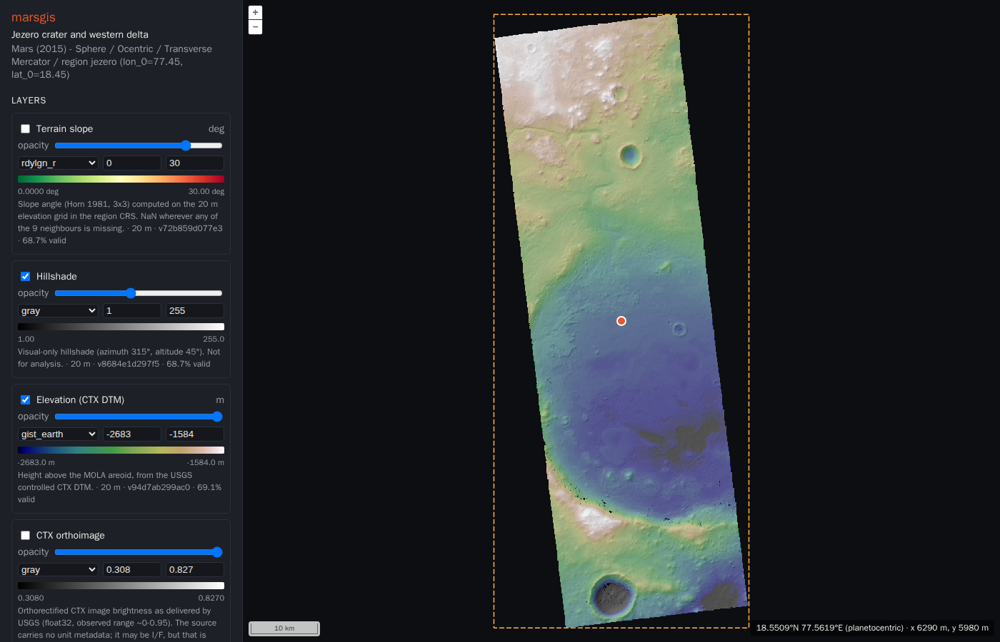

# marsgis — Mars exploration geospatial platform (prototype)

A verified vertical slice of a geospatial platform for planning Mars exploration routes. It:

1. downloads a **real Mars dataset**: the USGS Astrogeology controlled CTX DTM and
   orthoimage of **Jezero crater** (CC0, ~43 MB);
2. validates its metadata, records provenance, and warps it onto a **Mars-native
   regional grid** (IAU 2015 Mars sphere, planetocentric, east-positive, Transverse
   Mercator, 20 m);
3. derives **slope** and **hillshade** and writes versioned **Cloud Optimized GeoTIFFs**
   with STAC metadata;
4. serves tiles through **TiTiler** in Mars TileMatrixSets only (no Web Mercator, no
   Earth CRS anywhere), plus a multi-layer **pixel-inspection** API;
5. displays the layers in an **OpenLayers** map rendered in the regional Mars CRS. Each
   layer has its own visibility, opacity, colormap, rescale and legend, and clicking the
   map inspects every layer at that point.



## Stack

| Layer | Choice |
|---|---|
| Runtime | Docker Compose (arm64-native on Apple Silicon; amd64 works too) |
| Processing | Python 3.12, rasterio 1.5.2 (GDAL 3.12.2, PROJ 9.8.1 with IAU_2015), pyproj 3.8, NumPy |
| Storage | COG files on a bind-mounted `./data`, static STAC catalog |
| API | FastAPI + titiler.core 2.4 + morecantile 7.1 + planetcantile 0.6 |
| Web | Vite 8, TypeScript 5.9, OpenLayers 10.11, proj4js 2.22 |

The reasoning behind these choices is in [`docs/decisions.md`](docs/decisions.md), and the
evidence is in [`docs/research.md`](docs/research.md).

## Quick start

Requirements: Docker Desktop (or OrbStack), about 1 GB of disk, and internet access on
first run. Nothing else is installed on the host.

```bash
docker compose up --build
```

* `init-data` downloads the sources and builds the layers. This takes about 30 s and
  happens only once, because later runs are no-ops.
* Open the web map at **http://localhost:5173**.
* Open the API docs at http://localhost:8000/api/docs.

### Everyday commands

```bash
docker compose up -d --build          # start in background (rebuilds images if changed)
docker compose logs -f api            # follow API logs (JSON lines)
docker compose down                   # stop; ./data is kept
docker compose build --no-cache       # rebuild images from scratch

# tests (unit + integration against the processed sample) and lint
docker compose run --rm api python -m pytest -q
docker compose run --rm api ruff check src tests

# pipeline CLI
docker compose run --rm init-data marsgis build --region jezero     # (re)build, idempotent
docker compose run --rm init-data marsgis inspect /data/raw/ctx_dtm_P18_007925_P19_008650/<file>.tif
docker compose run --rm init-data marsgis inspect https://astrogeo-ard.s3-us-west-2.amazonaws.com/...tif
```

Source code is bind-mounted. The API reloads on changes under `backend/src` and `config`,
and Vite hot-reloads `frontend/src`. If you change dependencies (`backend/requirements.lock`
or `frontend/package.json`), rebuild with `--build`.

### Data persistence

| Path | Content | Disposable? |
|---|---|---|
| `data/raw/` | Verbatim downloads with `provenance.json` (SHA-256, URL, licence) | Yes, it is re-downloaded on the next build |
| `data/processed/` | Versioned COGs, one directory per content-addressed version | Yes, it is rebuilt from `raw` and `config` |
| `data/catalog/` | STAC items pointing at the current versions | Yes, it is rebuilt |

`data/` is a plain directory in the repo checkout and is git-ignored. It survives
`docker compose down` and container recreation. Never commit it.

## Using the prototype

* **Navigate**: pan and zoom. The map is in the regional CRS, so the scale bar is in true
  Mars metres. Zoom 5 is exactly the 20 m analysis grid, and deeper zooms show the cells
  as squares.
* **Layers** (sidebar): toggle visibility and change opacity, colormap, and min/max
  rescale. Legends update automatically, and defaults come from per-layer statistics.
* **Inspect**: click anywhere to get every layer's value at that grid cell (with units,
  or `nodata`/`outside`). The location is shown in planetocentric and planetographic
  latitude, east ±180 and west 0–360 longitude, region x/y, and grid row/col. A
  browser-vs-server CRS agreement check is displayed under the values.
* **API examples**

  ```bash
  curl 'http://localhost:8000/api/regions/jezero'                          # CRS, grid, layers, stats
  curl 'http://localhost:8000/api/regions/jezero/inspect?lon=77.45&lat=18.45'
  curl 'http://localhost:8000/api/regions/jezero/inspect?x=1010&y=-2010'
  curl -o t.png 'http://localhost:8000/api/cog/tiles/MarsJezeroTM/5/16/16.png?region=jezero&layer=elevation&rescale=-2700,-1600&colormap_name=gist_earth'
  # TiTiler's point endpoint needs an explicit Mars CRS (its default is EPSG:4326):
  curl 'http://localhost:8000/api/cog/point/77.45,18.45?region=jezero&layer=elevation&coord_crs=IAU_2015:49900'
  ```

## Repository layout

```
compose.yaml             services: init-data (pipeline), api, web
config/
  sources.yaml           external sources: URL, licence, expected CRS/dtype/nodata, units
  regions/jezero.yaml    region CRS, grid, layer recipes, render defaults
backend/
  Dockerfile, pyproject.toml, requirements.lock (uv pip compile --universal)
  src/marsgis/           crs, grid, ingest, processing, catalog, pipeline, tms, inspect, api/
  tests/                 31 tests: CRS, grid/TMS alignment, warping/nodata, terrain, API
frontend/                Vite + OpenLayers client (src/main.ts, src/api.ts)
docs/                    research, architecture, decisions, data-model
data/                    (git-ignored) raw/, processed/, catalog/
```

## Adding a layer

* **Another source raster** (for example a HiRISE DTM or a THEMIS mosaic): add an entry
  to `config/sources.yaml` with its URL and expected CRS, dtype, nodata and units. Then
  add an `op: warp` recipe to `config/regions/jezero.yaml` with an explicit resampling
  method and a resolution of `20 / 2^k`, and run `marsgis build`.
* **A derived layer**: implement the operation in `processing.py`, register an algorithm
  version in `ALGORITHM_VERSIONS`, add a test with an analytic expectation, and reference
  it with `op:` and `input:` in the region config.

The web client discovers layers from the API automatically.

## Current capabilities

All of the following are verified by tests and a headless-browser check.

* Mars-only CRS handling: Earth CRSs and missing CRSs are rejected. Ocentric/ographic
  latitude and east/west longitude conversions are tested.
* An aligned, nested, regional grid family: every published layer is checked for
  alignment.
* Content-addressed, idempotent, provenance-tracked builds, with raw data protected by
  checksums.
* Tiles at the base zoom are bit-identical to the analysis grid.
* Multi-layer pixel inspection that agrees with TiTiler's `/point` and with the raw COG.
* Browser coordinate transforms that agree with server PROJ to about 1e-9 m. This
  required working around two proj4js defects; see `docs/research.md` §4.

## Limitations

* One region and one small sample. Terrain derivation loads the whole layer into memory,
  and large regions will need windowed processing.
* The orthoimage's physical unit is undocumented by the source, so it is displayed as
  relative brightness only.
* There is no STAC API, PostGIS or object storage yet. These are deliberately deferred,
  and the seams are in place (`docs/decisions.md` D9).
* There are no vector datasets yet beyond footprints, and no routes, cost surfaces or ML.
* NASA challenge data formats are unknown. Ingestion currently handles GDAL-readable
  rasters only (GeoTIFF/COG, and in principle PDS3/PDS4/ISIS3 through GDAL, which is
  untested).
* The frontend has no lockfile committed yet. Direct dependencies are pinned exactly;
  generate one with
  `docker compose run --rm --no-deps -v "$PWD/frontend:/web" web npm install --package-lock-only`
  and commit it so that `npm ci` is used.

## Troubleshooting

* **`failed to fetch anonymous token … x509` during build**: something on the host
  (a corporate proxy or a sandbox) intercepts TLS for the BuildKit client. Use
  `DOCKER_BUILDKIT=0 docker compose build`, or fix the proxy CA in Docker's settings.
* **Map is empty**: check `docker compose logs init-data`. The first run needs internet
  access to `astrogeo-ard.s3-us-west-2.amazonaws.com` and `stac.astrogeology.usgs.gov`.

## Suggested next steps

1. Add a 1 m HiRISE DTM for part of the region at 20/16 = 1.25 m nested resolution, and
   use it for roughness (a wheel-scale terrain metric).
2. Add an `op: cost` recipe with a traversability cost from slope, roughness and
   hazards, using explicit units and NaN for impassable cells.
3. Add a route endpoint: run `skimage.graph.MCP_Geometric` on the cost layer, return
   GeoJSON with per-segment costs, and draw it as an OpenLayers vector layer.
4. Write ingestion adapters for the NASA datasets once they arrive (format, CRS, units
   and datum checks), and add a time dimension (Zarr/xarray) for environmental fields.
5. Add a CesiumJS 3-D context view (`Ellipsoid.MARS`) fed by the same tiles and DTM.
6. When there are many items, move to pgstac + titiler-pgstac and MinIO, and add PostGIS
   for routes.
7. Report the proj4js spherical-TM latitude-sign bug upstream.

## Data credit

USGS Astrogeology Science Center, Analysis Ready Data: MRO CTX controlled USGS DTMs
(`mro_ctx_controlled_usgs_dtms`, item `P18_007925_1987_XN_18N282W__P19_008650_1987_XI_18N282W`),
CC0-1.0. MRO/CTX: NASA/JPL/MSSS. Processing is by this project, and the layers are not
official NASA products.
