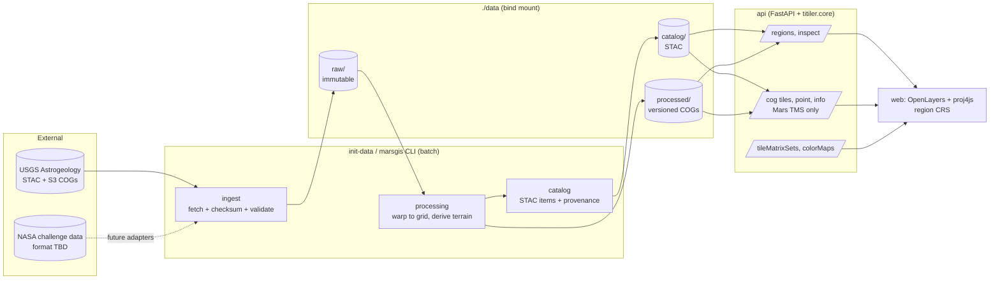

# Architecture

## 1. Overview

A **modular monolith**: one Python package (`backend/src/marsgis`) used by two processes,
plus a static web client. Everything runs in Docker Compose.

## 2. Components and responsibilities

| # | Responsibility | Module | Status |
|---|---|---|---|
| 1 | Data ingestion | `ingest.py`, `config/sources.yaml` | HTTP fetch, SHA-256, provenance, metadata validation against declared expectations |
| 2 | Scientific preprocessing | `processing.py` | Block-wise warp (WarpedVRT), COG writing, statistics |
| 3 | CRS & spatial alignment | `crs.py`, `grid.py`, `config/regions/*.yaml` | Mars-only CRS guard, regional TM, nested aligned grids |
| 4 | Derived layers | `processing.py` (`slope`, `hillshade`) | Horn gradients, NaN propagation; future: roughness, traversability |
| 5 | Raster/vector storage | filesystem `data/` (COG); vectors future | S3/MinIO-ready via GDAL VSI |
| 6 | Metadata & discovery | `catalog.py` | Static STAC per region |
| 7 | Geospatial API & tiles | `api/app.py`, `tms.py`, `inspect.py` | Region detail, multi-layer inspection, TiTiler tiles in Mars TMSs |
| 8 | Route planning & ML | — (planned, §7) | Consumes aligned layer stack |
| 9 | Frontend | `frontend/src` | OpenLayers in region CRS, per-layer styling, legends, inspection |

Orchestration is `pipeline.py`: topological order of layer recipes, content-addressed
versions, idempotent builds, alignment check before publishing.

## 3. Data flow

1. `sources.yaml` declares each external source: URL, licence, citation, **expected CRS
   name/dtype/nodata**, declared units and vertical datum (facts the file may not carry).
2. `ingest.fetch_source` downloads verbatim to `data/raw/<id>/` with `provenance.json`;
   `validate_source` fails on missing/non-Mars CRS or any mismatch with expectations.
3. `pipeline.build_region` processes layer recipes from `config/regions/<id>.yaml`:
   * `op: warp` — source → region grid (declared resampling), source nodata → NaN;
   * `op: slope | hillshade` — derived from another layer on the same grid.
4. Each output is verified to be grid-aligned, then described by a STAC Item (statistics,
   projection, provenance) in `data/catalog/<region>/`.
5. The API reads only the catalog and COGs (read-only mount). Tiles are rendered on demand
   by rio-tiler from COG overviews/blocks; `/inspect` reads single full-resolution cells.
6. The browser fetches `/api/regions/<id>` (CRS as PROJ string + WKT2, frame, TMS,
   layers, statistics, render defaults), builds its projection and tile grid from it —
   there is no CRS hard-coded in the frontend.

## 4. Storage architecture

* `data/raw` — immutable source copies; deletable only deliberately (re-fetch verifies
  checksum).
* `data/processed` — versioned COGs (`<layer>/<version>/<layer>.tif`), old versions kept.
* `data/catalog` — current pointers (STAC Items). Switching a layer version = rewriting
  one Item; rollback = point back to an older version directory.

Cloud path: the same tree on S3/MinIO. GDAL/rasterio read COGs via HTTP range requests
(range reads over HTTPS from the USGS S3 bucket were exercised during research via
`/vsicurl/`; `/vsis3/` for MinIO is documented but not yet tested here); only the asset
hrefs and credentials change. At larger scale, STAC Items move to pgstac and TiTiler to
titiler-pgstac for mosaics across many items.

## 5. Coordinate-system strategy

* One canonical body model (IAU 2015 Mars sphere), planetocentric, east-positive.
* Each region has its own projected CRS (TM, k0 = 1) and an aligned grid family.
* All processed rasters of a region share CRS + lattice → stacking without resampling.
* Conversions to other conventions (planetographic latitude, west longitude, 0–360) are
  display-only and computed in one place (`crs.py`, exposed by `/inspect`).
* Every CRS entering the system passes `assert_mars_crs`; Earth CRSs are rejected, and
  PROJ itself refuses Earth↔Mars transformations (tested), so third-party defaults to
  EPSG:4326 fail loudly instead of silently.
* Browser transforms use proj4js with a corrected definition and are cross-checked
  against server-side PROJ results.

Details: `docs/data-model.md`.

## 6. API boundaries

| Endpoint | Purpose |
|---|---|
| `GET /api/health` | Liveness, version, regions |
| `GET /api/regions` | Region list |
| `GET /api/regions/{id}` | CRS (WKT2, PROJ), frame, TMS id/zooms, layers with units, stats, render defaults, footprints |
| `GET /api/regions/{id}/inspect?x&y` or `?lon&lat` | All layer values at a cell + coordinates in all conventions + grid row/col; status `ok`/`nodata`/`outside` |
| `GET /api/regions/{id}/layers/{layer}/stac` | STAC Item |
| `GET /api/cog/tiles/{tms}/{z}/{x}/{y}[.png\|.npy\|...]?region&layer&rescale&colormap_name` | TiTiler tiles |
| `GET /api/cog/{info,statistics,tilejson.json,point/...}?region&layer` | TiTiler dataset endpoints (`point` requires `coord_crs=IAU_2015:49900`) |
| `GET /api/tileMatrixSets[/{id}]` | OGC TMS documents (Mars only) |
| `GET /api/colorMaps/{name}` | Colormap for legends |

OpenAPI: `http://localhost:8000/api/docs`. Future: `POST /api/regions/{id}/routes`
(route request → GeoJSON LineString + per-segment costs), `GET .../cost-surfaces/...`
(served as ordinary layers).

## 7. Frontend rendering architecture

* OpenLayers `Map` whose `View` projection is the region CRS (registered from the API's
  PROJ string via proj4js, with the documented proj4js workarounds).
* One `TileLayer<XYZ>` per layer with a `TileGrid` equal to the region TMS (origin
  top-left, resolutions `frame/256/2^z`); `extent` = layer bounds; `interpolate: false`
  so over-zoomed cells show as cells.
* Styling is server-side (TiTiler `rescale` + `colormap_name`); changing style swaps the
  layer source URL. Legends are drawn from `/api/colorMaps/{name}`.
* Vector layers: data footprints (STAC geometry → region CRS) and the inspection marker.
  Routes, waypoints and hazard polygons will be added as vector layers in the same CRS.
* Inspection: click → `/inspect` (exact cell values); pointer move → client-side lon/lat.
* 3-D (future): CesiumJS with `Ellipsoid.MARS` for context views; the 2-D analysis map
  stays in OpenLayers.

## 8. Path to route planning and ML

1. **Cost surface as a layer.** A new recipe op (e.g. `op: cost`) combines aligned inputs
   (slope, roughness, hazard masks, later radiation/temperature exposure) into a cost per
   cell, with explicit units (e.g. seconds or energy per metre) and NaN = impassable.
   Served and inspected like any other layer.
2. **Pathfinding.** 8-connected grid graph on the region lattice; costs scaled by step
   length (20 m or 20√2 m — valid because the CRS is metric, D2). Start with
   `skimage.graph.MCP_Geometric` (Dijkstra on rasters) or A* with a Euclidean heuristic;
   multi-objective via weighted sums first, then Pareto sets (e.g. label-setting) for
   distance vs exposure trade-offs. Route endpoint returns cells → x/y → lon/lat.
3. **Exposure accumulation.** Integrate per-cell exposure rates along the path
   (rate × traversal time), keeping units explicit.
4. **ML.** Training samples are windows of the aligned stack (xarray/Zarr), labels on the
   same lattice (e.g. traversability classes from rover drive data at Jezero). Models
   produce new layers (with model version as algorithm version in provenance) — so ML
   outputs are versioned, inspectable and usable as pathfinding costs.
5. **Uncertainty.** Carry per-layer uncertainty layers (e.g. DTM QA, HiRISE FOM) and
   evaluate route robustness by sampling.

Heavy jobs (pathfinding over large regions, ML inference) should move to a worker
process consuming the same package when they exceed request timescales.
