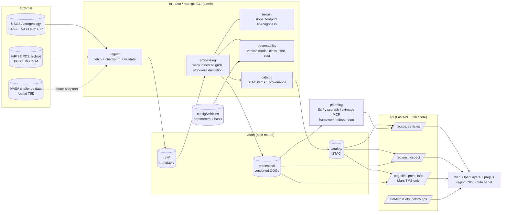

# Architecture

## 1. Overview

A **modular monolith**: one Python package (`backend/src/marsgis`) used by two processes,
plus a static web client. Everything runs in Docker Compose.



## 2. Components and responsibilities

| # | Responsibility | Module | Status |
|---|---|---|---|
| 1 | Data ingestion | `ingest.py`, `config/sources.yaml` | HTTP fetch, SHA-256, provenance, metadata validation against declared expectations |
| 2 | Scientific preprocessing | `processing.py` | Block-wise warp (WarpedVRT), COG writing, statistics |
| 3 | CRS & spatial alignment | `crs.py`, `grid.py`, `config/regions/*.yaml` | Mars-only CRS guard, regional TM, nested aligned grids |
| 4 | Derived layers | `processing.py` (strip/halo driver), `terrain.py` | Horn slope/hillshade; rover-footprint plane-fit tilt and roughness (`terrain-analysis.md`) |
| 4a | Traversability | `traversability.py`, `config/vehicles/*.yaml` | Vehicle-specific classes, traverse time, planning cost, with uncertainty bands (`traversability.md`) |
| 4b | Data quality | `quality.py` | Feature quantiles, cross-product DTM comparison on nested grids |
| 5 | Raster/vector storage | filesystem `data/` (COG); vectors future | S3/MinIO-ready via GDAL VSI |
| 6 | Metadata & discovery | `catalog.py` | Static STAC per region |
| 7 | Geospatial API & tiles | `api/app.py`, `tms.py`, `inspect.py` | Region detail, multi-layer inspection, TiTiler tiles in Mars TMSs |
| 8 | Route planning | `planning.py` (engine), `routing.py` (region service), `sensitivity.py` | Dijkstra (SciPy csgraph, no corner cutting) and MCP_Geometric on numerical cost rasters; diagnostics; sensitivity (`path-planning.md`) |
| 8a | ML | — | Deliberately not yet (`research.md` §15) |
| 9 | Frontend | `frontend/src` (`main.ts`, `route.ts`) | OpenLayers in region CRS, per-layer styling, categorical legends, inspection, route panel with profile |

Orchestration is `pipeline.py`: topological order of layer recipes, content-addressed
versions, idempotent builds, alignment check before publishing.

## 3. Data flow

1. `sources.yaml` declares each external source: URL, licence, citation, **expected CRS
   name/dtype/nodata**, declared units and vertical datum (facts the file may not carry).
2. `ingest.fetch_source` downloads verbatim to `data/raw/<id>/` with `provenance.json`;
   `validate_source` fails on missing/non-Mars CRS or any mismatch with expectations.
3. `pipeline.build_region` processes layer recipes from `config/regions/<id>.yaml` in
   dependency order:
   * `op: warp`: source → a member of the region grid family (20 m CTX, 1 m HiRISE;
     declared resampling), source nodata → NaN;
   * `op: slope | hillshade | plane_tilt | plane_roughness`: terrain features from an
     elevation layer on the same grid, computed in 512-row strips with an operator-radius
     halo (bounded memory, identical to whole-array results);
   * `op: traversability_class | traversal_time | traversal_cost`: a vehicle model
     (`config/vehicles/<id>.yaml`) applied to named feature inputs. The uncertainty is
     propagated from the root source's declared precision, and the vehicle parameters
     and uncertainty values become part of the version hash and provenance.
4. Each output is verified to be grid-aligned, then described by a STAC Item (statistics,
   projection, provenance) in `data/catalog/<region>/`.
5. The API reads only the catalog and COGs (read-only mount). Tiles are rendered on demand
   by rio-tiler from COG overviews/blocks; `/inspect` reads single full-resolution cells.
6. The browser fetches `/api/regions/<id>` (CRS as PROJ string + WKT2, frame, TMS,
   layers, statistics, render defaults, categories, planning configuration) and builds
   its projection and tile grid from it. No CRS is hard-coded in the frontend.
7. Route requests (`POST /api/regions/<id>/routes`) go through `routing.py`, which maps
   the vehicle to its planning layers (region `planning:` config) via the catalog. They
   then go to `planning.plan_route`, which reads the **numerical** cost, time and class
   COGs for a bounded window, runs Dijkstra, and samples feature layers along the path.
   The result includes the content-addressed versions of every input.

## 4. Storage architecture

* `data/raw` — immutable source copies; deletable only deliberately (re-fetch verifies
  checksum).
* `data/processed` — versioned COGs (`<layer>/<version>/<layer>.tif`), old versions kept.
* `data/catalog` — current pointers (STAC Items). Switching a layer version = rewriting
  one Item; rollback = point back to an older version directory.

Cloud path: the same tree on S3/MinIO. GDAL/rasterio read COGs via HTTP range requests
(range reads over HTTPS from the USGS S3 bucket were exercised during research via
`/vsicurl/`; `/vsis3/` for MinIO is documented but not yet tested here); only the asset
hrefs and credentials change. At larger scale, STAC Items move to pgstac and TiTiler to
titiler-pgstac for mosaics across many items.

## 5. Coordinate-system strategy

* One canonical body model (IAU 2015 Mars sphere), planetocentric, east-positive.
* Each region has its own projected CRS (TM, k0 = 1) and an aligned grid family.
* All processed rasters of a region share CRS + lattice → stacking without resampling.
* Conversions to other conventions (planetographic latitude, west longitude, 0–360) are
  display-only and computed in one place (`crs.py`, exposed by `/inspect`).
* Every CRS entering the system passes `assert_mars_crs`; Earth CRSs are rejected, and
  PROJ itself refuses Earth↔Mars transformations (tested), so third-party defaults to
  EPSG:4326 fail loudly instead of silently.
* Browser transforms use proj4js with a corrected definition and are cross-checked
  against server-side PROJ results.

Details: `docs/data-model.md`.

## 6. API boundaries

| Endpoint | Purpose |
|---|---|
| `GET /api/health` | Liveness, version, regions |
| `GET /api/regions` | Region list |
| `GET /api/regions/{id}` | CRS (WKT2, PROJ), frame, TMS id/zooms, layers with units, stats, render defaults, footprints |
| `GET /api/regions/{id}/inspect?x&y` or `?lon&lat` | All layer values at a cell + coordinates in all conventions + grid row/col; status `ok`/`nodata`/`outside` |
| `GET /api/regions/{id}/layers/{layer}/stac` | STAC Item |
| `GET /api/cog/tiles/{tms}/{z}/{x}/{y}[.png\|.npy\|...]?region&layer&rescale&colormap_name` | TiTiler tiles |
| `GET /api/cog/{info,statistics,tilejson.json,point/...}?region&layer` | TiTiler dataset endpoints (`point` requires `coord_crs=IAU_2015:49900`) |
| `GET /api/tileMatrixSets[/{id}]` | OGC TMS documents (Mars only) |
| `GET /api/colorMaps/{name}` | Colormap for legends |

| `GET /api/vehicles[/{id}]` | Vehicle list; all mobility parameters with value, unit, basis and source |
| `POST /api/regions/{id}/routes` | Body `{waypoints:[{lon,lat}\|{x,y}…], vehicle, engine: dijkstra\|mcp, margin_m}` → geometry (region CRS + lon/lat), summary, legs, per-vertex profile, class runs, warnings, input versions. Structured 4xx errors with `code`. At most 2 concurrent plans (503 otherwise). |

Cost, time and class surfaces are ordinary layers, so they are served as tiles and are
inspectable like any other layer. OpenAPI: `http://localhost:8000/api/docs`.

## 7. Frontend rendering architecture

* OpenLayers `Map` whose `View` projection is the region CRS (registered from the API's
  PROJ string via proj4js, with the documented proj4js workarounds).
* One `TileLayer<XYZ>` per layer with a `TileGrid` equal to the region TMS (origin
  top-left, resolutions `frame/256/2^z`); `extent` = layer bounds; `interpolate: false`
  so over-zoomed cells show as cells.
* Styling is server-side (TiTiler `rescale` + `colormap_name`); changing style swaps the
  layer source URL. Legends are drawn from `/api/colorMaps/{name}`.
* Vector layers: data footprints (STAC geometry → region CRS) and the inspection marker.
  Routes, waypoints and hazard polygons will be added as vector layers in the same CRS.
* Inspection: click → `/inspect` (exact cell values); pointer move → client-side lon/lat.
* 3-D (future): CesiumJS with `Ellipsoid.MARS` for context views; the 2-D analysis map
  stays in OpenLayers.

## 8. Terrain → traversability → route (implemented 2026-11-13)

```
raw HiRISE PDS3 IMG ──warp (bilinear, 1 m)──▶ hirise_elevation
   ├─ slope (Horn 3×3) ─────────────────────▶ hirise_slope          (reference)
   ├─ plane fit 5 m ────────────────────────▶ hirise_tilt_5m        ┐ vehicle-independent
   └─ plane residual 5 m ───────────────────▶ hirise_roughness_5m   ┘ features
                                 vehicle YAML + σ from source precision
   tilt, roughness ──▶ traversability model ─▶ trav_class_<v>, time_<v>, cost_<v>
   cost/time/class (+ samples) ──▶ planning.plan_route (SciPy / scikit-image Dijkstra)
                                 ──▶ route JSON (geometry, totals, profile, provenance)
```

Separation of concerns: `terrain.py` has no vehicle knowledge; `traversability.py`
has no I/O; `planning.py` reads rasters and coordinates but imports no API code;
`routing.py` is the only place that knows about the catalog and region config;
`api/app.py` validates requests and maps errors to HTTP codes. The frontend only
visualises the structured results.

Remaining extensions (documented in the respective docs): rock abundance and terrain
classes as further feature inputs; probabilistic hazards; directional and heading-aware
planning on a directed graph or state lattice; hierarchical CTX→HiRISE planning after
vertical co-registration; ML layers (classes, slip) written back as versioned layers.
If planning jobs outgrow request time, a worker process consuming the same package is
the next architectural step. No queue or broker is needed before then.
